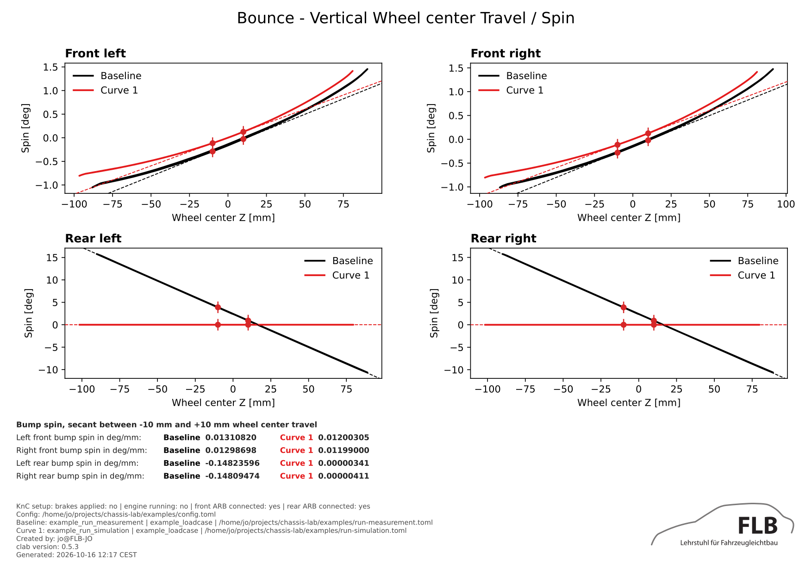
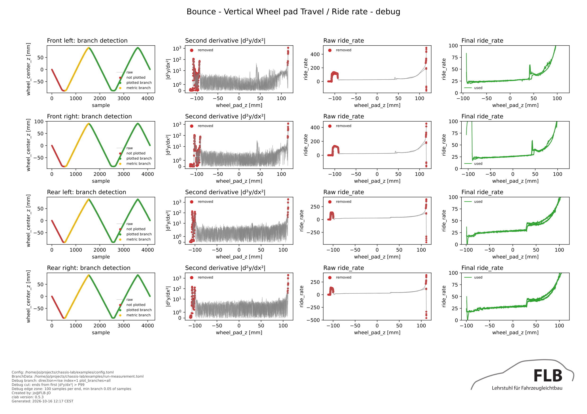

# ChassisLab

ChassisLab (Chassis Laboratory) converts, analyzes, and compares vehicle chassis
simulation and measurement data. Rust manages data and workflows. Embedded
Python provide scientific computing and plotting. The project also includes a
small MATLAB multibody solver for research and prototyping.

## Workflow

```text
convert → inspect → analyze → compare
```

🔄 **Convert** Adams `.res` simulation results or Lommel `.acd` measurements to
a common HDF5 format.

🔍 **Inspect** the signals in an HDF5 file before configuring an analysis.

📊 **Analyze** data from a single input or a run file to compute metrics and
curves.

⚖️ **Compare** candidates against a baseline.

🧮 **Solve** the kinematics of a multibody model defined in JSON.

🎯 **Optimize** a design against objectives defined in a TOML problem file.

## 👀 Preview

| Compare Plot                                                 | Debug                                                      |
| ------------------------------------------------------------ | ---------------------------------------------------------- |
|  |  |

## Pre-built executables

Download archive
[latest release](https://github.com/JensOlschewski/chassis-lab/releases/latest).

Extract complete archive. Keep bin/, embedded Python runtime, libraries, and
dependencies together.

```bash
bin/clab --help
```

Release archives include embedded CPython runtime and scientific dependencies.
No Python, pip, virtual environment, or Rust toolchain needed.

## Configuration ⚙️

`config.toml` is the main configuration file. One configuration can be shared
across simulation and measurement runs.

Configuration is modular. `config.toml` references setup, mappings, and optional
tolerance files.

| File                                       | Purpose                                                               |
| ------------------------------------------ | --------------------------------------------------------------------- |
| `config.toml`                              | Main configuration file                                               |
| `setup.toml`                               | General test setup.                                                   |
| `mappings/mappings-<source>-<domain>.toml` | Maps source signals to ChassisLab signals and units                   |
| `tolerances.toml`                          | Optional absolute and relative tolerances used with (`--tolerances`). |

```toml
[physics]
gravity = 9.80665 # m/s²

[setup]
file = "setup.toml"

# Example mapping: simulation source, SVC domain
[mappings.simulation.svc]
file = "mappings/mappings-simulation-svc.toml"

[compare]
file = "tolerances.toml"
```

## Commands `>_`

### 🔄 clab convert

Convert raw simulation or measurement data to HDF5. By default, the output is
written next to the input with its extension replaced by `.h5`.

```bash
clab convert input.res --domain svc
```

```bash
clab convert input.acd --domain knc --test vertical --setup b1e1f1r1
```

Lateral tests also need `--phase` and `--offset`:

```bash
clab convert lat.res --domain knc --test lateral --setup b1e0f1r1 --phase in --offset 30
```

- `--output` (`-o`): Write to a specified file or directory. A path ending in
  `/` is treated as a directory and created if missing.
- `--force`: Replace an existing output file.
- `--domain` (`-d`): Required. Use `svc` or `knc`.
- `--test` (`-t`): Required for `knc`; not allowed for `svc`. Use `vertical`,
  `roll`, `static`, `longitudinal`, or `lateral`.
- `--setup bXeXfXrX`: Required for `knc`. A `1` means brakes applied (`b`),
  steering engine on (`e`), or the front (`f`) or rear (`r`) anti-roll bar
  connected. A `0` means the opposite.
- `--phase`: Required for `lateral`. Use `in` or `anti` to set the phase
  relationship between the left and right wheels' lateral forces.
- `--offset MM`: Required for `lateral`. Sets the pneumatic trail offset in mm.
- `--yes` (`-y`): Proceed without prompting when motion data disagrees with
  `--test`.

### 🔍 clab inspect

Inspect a h5 or solver solution json file:

```bash
clab inspect examples/input/raw-measurement/example-measurement-knc-vertical.h5 --list
```

Create a mapping template for KnC vertical analysis:

```bash
clab inspect --mapping knc --test vertical --template
```

- `--mapping svc|knc` shows mapping requirements without opening an input file
- `--test TEST` filters KnC requirements, and `--template` emits a TOML
  skeleton.

A solver solution (from `clab solve --json`) prints a summary with the steps,
time range, body and joint counts and the peak velocity per body:

```bash
clab inspect reports/solution.json
clab inspect reports/solution.json --view [VIEW_FILE]
```

- For HDF5 files and solver solutions, `--list` lists available signals and
  `--match TEXT` filters the list.
- `--signal NAME --json` returns selected values and the time axis for HDF5
  files or solver solutions. Repeat `--signal` to select multiple signals;
  append `.x`, `.y`, or `.z` to select a vector component.
- In `problem.toml`, prefix a listed solution path with its `[models]` alias,
  e.g. `pwt.characteristics.wheel_velocities.l_wc.x`.
- `--view [FILE]` opens the solution viewer; `FILE` optionally specifies a
  layout.
- `--json` returns JSON. For solutions, it includes the summary, signals, and
  viewer frames; `--view FILE` selects the frame layout.

### 📊 clab analyze

Analyze one normalized input or run manifest to calculate metrics and curves.

```bash
clab analyze examples/config.toml examples/input/run-simulation.toml
```

- `--report PATH` (`-r`) write a report bundle.
- `--label NAME` (`-l`) to explicitly name the input in plot legends and report.
  The default is "Simulation" or "Measurement".
- `--debug` to include KnC rate-filter diagnostic plots in the report (needs
  `--report`).
- `--verbose` (`-v`) to print default-value warnings, also when output is
  redirected.
- `--force` to replace an existing report bundle.
- `--json` to print one JSON line per analysis section instead of console text.
  to print one JSON line per analysis section instead of console text

Create report and label.

```bash
clab analyze examples/config.toml examples/input/run-simulation.toml \
    --report reports/simulation \
    --label "Simulation"
```

### ⚖️ clab compare

Compare a baseline with one or more compatible candidates (SVC or KnC vertical
inputs).

- `--tolerances` (`-t`) for pass/fail status from config tolerances.
- `--report PATH` (`-r`) write a report bundle.
- `--label NAME` (`-l`) once per input, baseline first. An empty name keeps the
  default ("Baseline", "Curve N").
- `--debug` to include KnC rate-filter diagnostic plots in the report (needs
  `--report`).
- `--force` to replace an existing report bundle.
- `--json` to print one JSON line per comparison section instead of console
  text.

```bash
clab compare examples/config.toml \
    examples/input/run-simulation.toml \
    examples/input/run-measurement.toml \
    --tolerances --report reports/compare \
    --label "Simulation" --label "Measurement"
```

### 🧮 clab solve

Solve a multibody kinematic or compliant model defined in JSON.

- `--json [PATH]` write the solution as JSON. Without a path it writes
  `<model>-solution.json` in the current directory. A directory path receives
  that file name. The solution is format 2: `bodies` and `joints` are keyed by
  the names in the model. Solutions from older versions need solving again.
- `--design FILE` apply design variables from a flat JSON object, e.g.
  `{"HP_L_X": 3945.2}`
- `--view [FILE]` step through the solution in a terminal viewer. An optional
  JSON view file picks bodies, points and shapes.
- `--progress` print solver progress to stderr.
- `--force` to replace an existing solution file (needs `--json`).

```bash
clab solve matlab/examples/mlta-model-file-1e2.json \
    --design matlab/examples/mlta-design-file-1e2.json \
    --json reports/solution.json
```

Without `--json` or `--view` it prints the time and the body velocities as text.

### 🎯 clab optimize

Optimize a multibody model design against objectives and constraints defined in
a TOML problem file.

- `--design FILE` start from design variables in a JSON file. Without it,
  optimization starts at the midpoint of the problem bounds.
- `--dry-run` evaluate the starting design without optimization.
- `--json [PATH]` write the optimized design as JSON. Without a path, it writes
  `<problem>-optimized.json` in the current directory. A directory path receives
  that file name.
- `--force` replace an existing JSON output (requires `--json`).
- `--progress` print optimizer progress to stderr.
- `--yes` (`-y`) proceed without prompting when `--design` is not given.

```bash
clab optimize examples/problem.toml \
    --design examples/design.json \
    --json reports/optimized-design.json
```

#### `clab` on the command line

The desktop app includes clab, which means no separate CLI installation is
needed.

#### MATLAB Runtime and `mks_solver`

Desktop and `clab` archives ship `mks_solver` and a small installer for the
Runtime. `clab runtime install` (or the **Install MATLAB Runtime…** button in
the Solve pane) installs the Runtime for the current user. Environment variables
(only needed for non-standard installs):

- `CLAB_MATLAB_RUNTIME` path to the MATLAB Runtime R2024b root. Without it
  `clab` checks the standard R2024b install locations.
- `CLAB_MKS_SOLVER` path to the `mks_solver` executable. Without it `clab` looks
  next to the `clab` executable.

```bash
export CLAB_MATLAB_RUNTIME=/opt/mcr/R2024b
export CLAB_MKS_SOLVER=$PWD/dist/mks-solver/mks_solver
```
