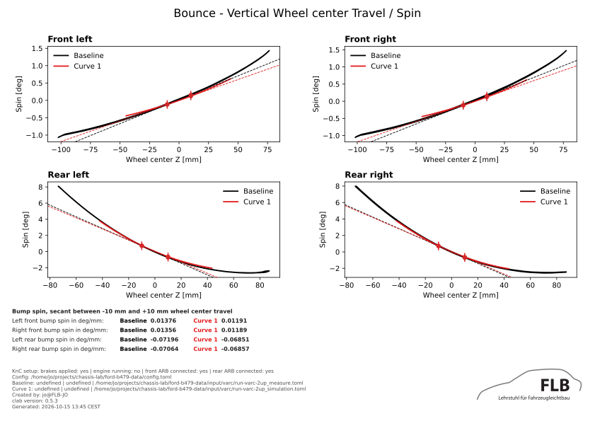

# ChassisLab

ChassisLab, or Chassis Laboratory, analyzes and compares vehicle chassis
simulation and measurement data. Rust owns `clab` workflow, input validation,
reports, and output safety. Embedded Python provides scientific kernels and
plotting.

## Workflow

```text
convert → inspect → analyze → compare
```

🔄 **Convert** raw Adams `.res` simulations or Lommel `.acd` measurements to
canonical HDF5. \
🔍 **Inspect** normalized files and available signals before configuring
analysis. \
📊 **Analyze** one normalized input or run manifest to calculate metrics and
curves. \
⚖️ **Compare** baseline with compatible candidates. Tolerances enable acceptance
checks.

## 👀 Preview

| Compare Plot                                                 | Debug                                                      |
| ------------------------------------------------------------ | ---------------------------------------------------------- |
|  |  |

## Pre-built executables

Download archive
[latest release](https://github.com/JensOlschewski/chassis-lab/releases/latest).

Extract complete archive. Keep bin/, embedded Python runtime, libraries, and
dependencies together.

```bash
bin/clab --help
```

Release archives include embedded CPython runtime and scientific dependencies.
No Python, pip, virtual environment, or Rust toolchain needed.

## Configuration ⚙️

`config.toml` defines reusable configuration file. One configuration can be
shared across simulation and measurement runs.

Configuration is modular. `config.toml` references setup, mappings, and optional
tolerance files.

`run.toml` defines input files and case metadata for each analysis or
comparison.

| File              | Purpose                                                             |
| ----------------- | ------------------------------------------------------------------- |
| `config.toml`     | Main configuration file                                             |
| `setup.toml`      | Test setup.                                                         |
| `mappings.toml`   | Mappings source signals to ChassisLab signals and units.            |
| `tolerances.toml` | Optional absolute and relative tolerances used by (`--tolerances`). |
| `run.toml`        | Run collection for `analyze` or `compare`.                          |

## Commands `>_`

### 🔄 clab convert

Convert raw simulation or measurement data to HDF5. Default output is `INPUT.h5`

- Use `--output` for an explicit file.
- Use `--force` to replace an existing output.
- `--domain` (`-d`) is required and defines test domain > (`svc`|`knc`)
- `--test` (`-t`) is required for `knc` > (`vertical`|`static`)

```bash
clab convert examples/input/example-measurement-knc-vertical.acd \
    -d knc -t vertical \
    --output input/converted-measurement-knc-vertical.h5
```

### 🔍 clab inspect

`--list` to show signals and \
`--match TEXT` to filter them \
`--mapping svc|knc` displays mapping requirements without opening an input file

Inspect a measurement HDF5 file:

```bash
clab inspect input/converted-measurement-knc-vertical.h5 --list
```

Create a mapping template for KnC vertical analysis:

```bash
clab inspect --mapping knc --test vertical --template
```

### 📊 clab analyze

Analyze one normalized input or run manifest to calculate metrics and curves.

- Use `--report PATH` to write a report bundle (SVC: JSON/CSV; KnC vertical:
  JSON/CSV/PDF).
- Use `--debug` for measurement branch detection diagnostics (needs `--report`).
- Use `--verbose` (`-v`) to print default-value warnings.
- Use `--force` to replace an existing report bundle.

```bash
 clab analyze examples/config.toml examples/run-simulation.toml
```

### ⚖️ clab compare

Compare compatible SVC or KnC baseline and candidate inputs.

- Use `--tolerances` (`-t`) for pass/fail status from config tolerances (without
  it, metrics are informational only).
- Use `--report PATH` to write a report bundle.
- Use `--debug` for measurement rate-filter diagnostics (needs `--report`).
- Use `--force` to replace an existing report bundle.

```bash
 clab compare examples/config.toml BASELINE CANDIDATE \
   --tolerances --report reports/compare
```
