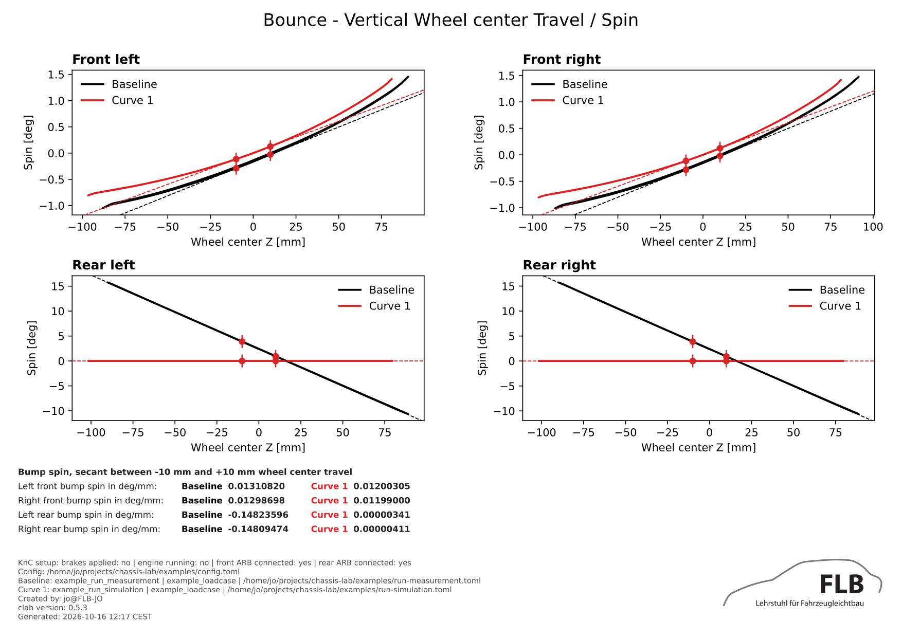
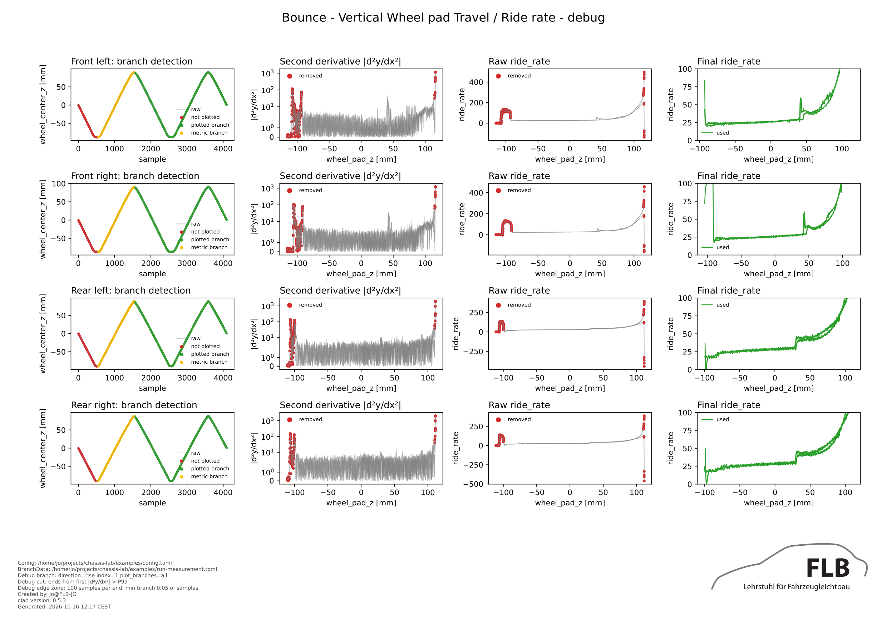

# ChassisLab

ChassisLab, or Chassis Laboratory, analyzes and compares vehicle chassis
simulation and measurement data. Rust owns `clab` workflow, input validation,
reports, and output safety. Embedded Python provides scientific kernels and
plotting.

## Workflow

```text
convert → inspect → analyze → compare
```

🔄 **Convert** raw Adams `.res` simulations or Lommel `.acd` measurements to
canonical HDF5. \
🔍 **Inspect** normalized files and available signals before configuring
analysis. \
📊 **Analyze** one normalized input or run manifest to calculate metrics and
curves. \
⚖️ **Compare** baseline with compatible candidates. Tolerances enable acceptance
checks. \
🧮 **Solve** multibody kinematic models defined in JSON and write the solution
as JSON, or view it in a terminal viewer. Standalone, not part of the flow above.

## 👀 Preview

| Compare Plot                                                 | Debug                                                      |
| ------------------------------------------------------------ | ---------------------------------------------------------- |
|  |  |

## Pre-built executables

Download archive
[latest release](https://github.com/JensOlschewski/chassis-lab/releases/latest).

Extract complete archive. Keep bin/, embedded Python runtime, libraries, and
dependencies together.

```bash
bin/clab --help
```

Release archives include embedded CPython runtime and scientific dependencies.
No Python, pip, virtual environment, or Rust toolchain needed.

## Configuration ⚙️

`config.toml` defines reusable configuration file. One configuration can be
shared across simulation and measurement runs.

Configuration is modular. `config.toml` references setup, mappings, and optional
tolerance files.

| File                                       | Purpose                                                                |
| ------------------------------------------ | ---------------------------------------------------------------------- |
| `config.toml`                              | Main configuration file                                                |
| `setup.toml`                               | General test setup.                                                    |
| `mappings/mappings-<source>-<domain>.toml` | Maps source signals to ChassisLab signals and units, one file per pair |
| `tolerances.toml`                          | Optional absolute and relative tolerances used by (`--tolerances`).    |

`<source>` is `simulation` or `measurement`, and `<domain>` is `svc` or `knc`,
so there are four mapping files. Each is referenced from `config.toml`:

```toml
[physics]
gravity = 9.80665 # m/s²

[setup]
file = "setup.toml"

[mappings.simulation.svc]
file = "mappings/mappings-simulation-svc.toml"

[compare]
file = "tolerances.toml"
```

`run.toml` defines input files and case metadata (`[meta]`, `[input.svc]`,
`[input.knc.<test>]`) for each analysis or comparison. Input paths resolve
relative to the run file.

## Commands `>_`

### 🔄 clab convert

Convert raw simulation or measurement data to HDF5. Default output is `INPUT.h5`

```bash
clab convert input.res --domain svc
```

```bash
clab convert input.acd --domain knc --test vertical --setup b1e1f1r1
```

Lateral tests also need `--phase` and `--offset`:

```bash
clab convert lat.res -d knc -t lateral --setup b1e0f1r1 --phase in --offset 30
```

- `--output` (`-o`) for an explicit file, or a directory. A path ending in `/`
  is a directory and is created if missing.
- `--force` to replace an existing output.
- `--domain` (`-d`) is required and defines the test domain > (`svc`|`knc`)
- `--test` (`-t`) is required for `knc` and not allowed for `svc` >
  (`vertical`|`roll`|`static`|`longitudinal`|`lateral`)
- `--setup bXeXfXrX` is required for `knc` (brakes, steering engine, front ARB,
  rear ARB; each 0 or 1)
- `--phase in|anti` is required for `lateral`. It sets the lateral force phase of
  the left and right wheels.
- `--offset MM` is required for `lateral`. It sets the pneumatic trail offset in
  mm.
- `--yes` (`-y`) to proceed without prompting when motion data disagrees with
  `--test`

### 🔍 clab inspect

Inspect a measurement HDF5 file:

```bash
clab inspect examples/input/raw-measurement/example-measurement-knc-vertical.h5 --list
```

Create a mapping template for KnC vertical analysis:

```bash
clab inspect --mapping knc --test vertical --template
```

- `--list` to show all signals.
- `--match TEXT` to filter them.
- `--mapping svc|knc` displays mapping requirements without opening an input
  file.
- `--test TEST` restricts the KnC mapping output to one test.
- `--signal NAME` to read one signal by its listed name. Repeatable, needs
  `--json`.
- `--json` to emit JSON for `--list`, `--match` or `--signal` (HDF5 only).
- `--template` emits an editable TOML mapping skeleton.

### 📊 clab analyze

Analyze one normalized input or run manifest to calculate metrics and curves.

```bash
clab analyze examples/config.toml examples/input/run-simulation.toml
```

- `--report PATH` (`-r`) write a report bundle.
- `--label NAME` (`-l`) to explicitly name the input in plot legends and report.
  The default is "Simulation" or "Measurement".
- `--debug` to include KnC rate-filter diagnostic plots in the report (needs
  `--report`).
- `--verbose` (`-v`) to print default-value warnings, also when output is
  redirected.
- `--force` to replace an existing report bundle.
- `--json` to print one JSON line per analysis section instead of console text. to print one JSON line per analysis section instead of console text

Create report and label.

```bash
clab analyze examples/config.toml examples/input/run-simulation.toml \
    --report reports/simulation \
    --label "Simulation"
```

### ⚖️ clab compare

Compare a baseline with one or more compatible candidates (SVC or KnC vertical
inputs).

- `--tolerances` (`-t`) for pass/fail status from config tolerances.
- `--report PATH` (`-r`) write a report bundle.
- `--label NAME` (`-l`) once per input, baseline first. An empty name keeps the
  default ("Baseline", "Curve N").
- `--debug` to include KnC rate-filter diagnostic plots in the report (needs
  `--report`).
- `--force` to replace an existing report bundle.
- `--json` to print one JSON line per comparison section instead of console text.

```bash
clab compare examples/config.toml \
    examples/input/run-simulation.toml \
    examples/input/run-measurement.toml \
    --tolerances --report reports/compare \
    --label "Simulation" --label "Measurement"
```

### 🧮 clab solve

Solve a multibody kinematic or compliant model defined in JSON.

- `--json [PATH]` write the solution as JSON. Without a path it writes
  `<model>-solution.json` in the current directory. A directory path receives
  that file name.
- `--include LIST` choose `bodies`, `connectors` and `suspension` for the JSON
  (needs `--json`). Without it all three are off.
- `--design FILE` apply design variables from a flat JSON object, e.g.
  `{"HP_L_X": 3945.2}`
- `--view [FILE]` step through the solution in a terminal viewer. An optional
  JSON view file picks bodies, points and shapes.
- `--progress` print solver progress to stderr.
- `--force` to replace an existing solution file (needs `--json`).

```bash
clab solve matlab/examples/mlta-model-file-1e2.json \
    --design matlab/examples/mlta-design-file-1e2.json \
    --json reports/solution.json \
    --include bodies,connectors
```

Without `--json` or `--view` it prints the time and the body velocities as text.

#### MATLAB Runtime and `mks_solver`

Environment variables (only needed for non-standard installs):

- `CLAB_MATLAB_RUNTIME` path to the MATLAB Runtime R2024b root. Without it
  `clab` checks the standard R2024b install locations.
- `CLAB_MKS_SOLVER` path to the `mks_solver` executable. Without it `clab` looks
  next to the `clab` executable.

```bash
export CLAB_MATLAB_RUNTIME=/opt/mcr/R2024b
export CLAB_MKS_SOLVER=$PWD/dist/mks-solver/mks_solver
```
