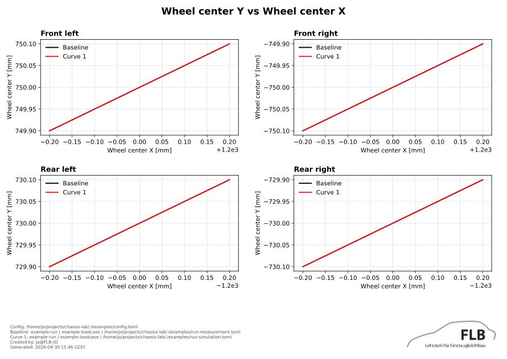

# ChassisLab

ChassisLab, or Chassis Laboratory, analyzes and compares vehicle chassis
simulation and measurement data. Rust owns `clab` workflow, input validation,
reports, and output safety. Embedded Python provides scientific kernels and
plotting.

<p align="center">
  
</p>

## Workflow

```text
convert → inspect → analyze → compare
```

🔄 **Convert** raw Adams `.res` simulations or Lommel `.acd` measurements to
canonical HDF5. \
🔍 **Inspect** normalized files and available signals before configuring
analysis. \
📊 **Analyze** one normalized input or run manifest to calculate metrics and
curves. \
⚖️ **Compare** baseline with compatible candidates. Tolerances enable acceptance
checks.

## Pre-built executables

Download archive
[latest release](https://github.com/JensOlschewski/chassis-lab/releases/latest).

Extract complete archive. Keep bin/, embedded Python runtime, libraries, and
dependencies together.

```bash
bin/clab --help
```

Release archives include private embedded CPython runtime and scientific
dependencies. No Python, pip, virtual environment, or Rust toolchain needed.

## Configuration ⚙️

`config.toml` defines reusable configuration file. One configuration can be
shared across simulation and measurement runs.

Configuration is modular. `config.toml` references setup, mappings, and optional
tolerance files.

`run.toml` defines input files and case metadata for each analysis or
comparison.

| File              | Purpose                                                             |
| ----------------- | ------------------------------------------------------------------- |
| `config.toml`     | Main configuration file                                             |
| `setup.toml`      | Test setup and KnC travel-window parameters.                        |
| `mappings.toml`   | Maps source signals to canonical ChassisLab signals and units.      |
| `tolerances.toml` | Optional absolute and relative comparison tolerances.               |
| `run.toml`        | Run-specific input paths and provenance for `analyze` or `compare`. |

## Commands `>_`

### clab convert

Convert raw simulation or measurement data to HDF5. Default output is
`INPUT.h5`. Use `--output` for explicit file definition or write in an existing
directory. Use `--force` to replace an existing output.

```bash
clab convert examples/input/example-measurement-knc-vertical.acd \
    --output input/converted-measurement-knc-vertical.h5
```

### clab inspect

Inspect a HDF5 or SVC JSON input.

`--list` to show signals and \
`--match TEXT` to filter them \
`--mapping svc|knc` displays mapping requirements without opening an input file

Inspect a measurement HDF5 file:

```bash
clab inspect input/converted-measurement-knc-vertical.h5 --list
```

Create a mapping template for KnC vertical analysis:

```bash
clab inspect --mapping knc --test vertical --template
```

### clab analyze

Analyze one normalized input or a multi-domain run manifest. Configuration owns
mappings, units, conventions, physics, and setup. Use `--report DIRECTORY` to
write a report bundle: SVC analysis creates JSON and CSV; KnC vertical analysis
creates JSON and SVG plots.

```bash
mkdir -p reports/example
clab analyze examples/config.toml examples/run-simulation.toml --report reports/example
```

### clab compare

Compare compatible SVC or KnC vertical baseline and candidate inputs. Without
`--tolerances`, complete metrics are informational. With it, configured
tolerances produce pass/fail status. Replace `BASELINE` and `CANDIDATE` with
compatible normalized inputs or run manifests.

```bash
clab compare examples/config.toml BASELINE CANDIDATE \
  --tolerances --report reports/compare
```
